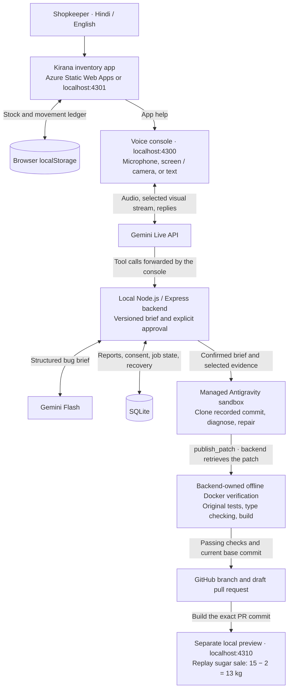

# किराना साथी — Hindi voice bug repair

A local developer tool that listens to a Hindi or English bug report, receives screen/camera frames through Gemini Live, prepares an agreed bug brief, and dispatches managed Antigravity to repair a public kirana inventory application. The backend independently verifies the patch before creating a draft GitHub PR and an isolated preview.

Inventory: [public repository](https://github.com/monuminu/kirana-saathi-demo) and [Azure demo](https://thankful-bay-05dfcb500.1.azurestaticapps.net/).

## App demo video

**[▶ Watch / download the Kirana Saathi app demo (MP4)](https://github.com/monuminu/gemini-kirana-bugfix-agent/releases/download/demo-video-2026-11-01/kirana-saathi-app-demo.mp4)**

The original recording is approximately **7 minutes** long. It is hosted unchanged as a [GitHub release asset](https://github.com/monuminu/gemini-kirana-bugfix-agent/releases/tag/demo-video-2026-11-01), so cloning either source project does not download the large video. Open the MP4 in your browser or download it to play locally.

## Architecture and workflow

The shopkeeper records inventory transactions in the kirana app. The companion voice console handles bug reporting and repair progress. Both interfaces have a top-right Hindi/English switch.



1. **Demonstrate the bug.** Reset the inventory app, then sell 2 kg of sugar from 15 kg. The deliberately faulty app shows 17 kg.
2. **Describe it in Hindi or English.** Open app help, speak or type the problem, and optionally share the app screen or webcam. Explicitly attach an image if it should be sent to the repair agent.
3. **Confirm the scope.** Gemini reads back the current bug brief in the selected language. A subsequent explicit approval, such as “हाँ, इसे ठीक कर दीजिए,” authorizes that exact report version. A correction requires a fresh read-back and approval.
4. **Run the repair.** Antigravity clones the allowed repository at the recorded commit, reproduces the failure, diagnoses the code, changes it, and runs checks. The conversation can continue while the background job runs.
5. **Verify and publish.** The backend retrieves the proposed patch and independently runs the original tests, type checking, and build in an offline Docker container. Failed checks, unrelated changes, a stale base, or cancellation stop publication. A passing candidate becomes a branch and one draft PR.
6. **Prove the corrected behavior.** A separate container builds the exact PR commit. Its artifact must match the verified candidate, and a browser replay must show **13 kg**, including after reload, before the preview is ready. Merging the PR remains a human review step.

| Component | Where it runs | Responsibility |
| --- | --- | --- |
| Kirana inventory app | Browser; hosted on Azure Static Web Apps or served locally | Product search, receipts, sales, low-stock alerts, ledger, synthetic browser storage |
| Voice console | Local browser | Audio capture/playback, one visual stream at up to 1 frame/second, transcripts, evidence selection, tool forwarding |
| Gemini Live (`gemini-3.8-live`) | Gemini API | Real-time voice/vision conversation and four asynchronous repair tools |
| Express backend | Local machine, bound to `127.0.0.1` | Ephemeral tokens, report-version approval, dispatch, status, cancellation, verification, GitHub publication |
| Gemini Flash (`gemini-3.8-flash`) | Gemini API | Schema-validated bilingual bug briefs and contextual approval classification |
| SQLite | Local machine | Reports, transcript turns, consent, jobs, provider IDs, timings, restart recovery |
| Antigravity (`antigravity-preview-09-2026`) | Fresh managed remote sandbox | Code diagnosis and repair from the confirmed brief, recorded source commit, and selected evidence |
| Docker verifier and preview | Local machine | Independent checks without secrets or network; separate preview of the exact published commit |
| GitHub | Public inventory repository | Repair branch, sanitized test evidence, draft PR for review |

The browser connects directly to Gemini Live using a constrained ephemeral token issued by the backend. Live's `prepare_bug_fix`, `dispatch_bug_fix`, `get_fix_status`, and `cancel_bug_fix` calls are forwarded to the backend with their original call IDs. The long-lived Gemini key and GitHub write credential stay on the backend; Antigravity submits a patch through `publish_patch` rather than pushing directly.

The Azure site remains the reproducible buggy baseline. The repair preview is a separate local URL, and neither PR creation nor merging automatically redeploys Azure. See [runner details](docs/runner.md) for the execution, verification, publication, and recovery contracts.

## Run locally

Use Node.js 22.13 or newer, a running Docker Desktop with a Docker CLI context, and GitHub CLI signed into the repository owner account.

```sh
npm ci --ignore-scripts
npx playwright install chromium
test -f .env.local || cp .env.example .env.local
# Set GEMINI_API_KEY in .env.local. Keep this file private.
# Optionally set a fine-grained GITHUB_TOKEN for the demo repo (Contents and Pull requests read/write).
# For this local release, an existing gh keychain credential is used in memory when GITHUB_TOKEN is absent.
npm run dev
```

On Linux, install the browser's required system libraries with `npx playwright install --with-deps chromium` during machine setup. The preview checker can also use an existing Google Chrome installation when the bundled browser is absent. The verifier requires anonymous access to the public Node image and the public Microsoft npm mirror for integrity-checked package preparation. Candidate installation and checks run offline in Docker.

Open http://127.0.0.1:4300 . Vite serves the console on 4300 and proxies `/api` to the loopback backend on 4302. The inventory app can run separately on 4301 or use its Azure Static Web Apps URL.

The browser receives a short-lived, constrained Live token. The long-lived Gemini key and GitHub credential stay on the backend. `.env.local`, runtime SQLite, media, logs and candidate checkouts are ignored by Git.

```sh
npm test
npm run typecheck
npm run build
npm start
npm run preflight -- --agent
npm run probe
```

The production start command serves the built console and API together on 127.0.0.1:4300. The application intentionally refuses remote network exposure in this release.

## Demo

Both the [Azure inventory app](https://thankful-bay-05dfcb500.1.azurestaticapps.net/) and this help console have a top-right Hindi/English switch. It translates labels, product names/units, reports and progress while preserving stock, form input, jobs and original transcripts. The preference survives reload. Links carry `?lang=hi` or `?lang=en`; you can bookmark an English demonstration directly.

The selected console language also configures Gemini's speech. Changing language during a call pauses the microphone and screen sharing. Press **Start talking / बात शुरू करें** to continue in the new language. A confirmed repair keeps running. Bug briefs remain bilingual, and the backend still requires complete read-back and explicit approval of the current version.

1. Reset the companion kirana app to synthetic seed data. Sugar starts at 15 kg.
2. Record a 2 kg sale. The deliberately faulty source produces 17 kg.
3. Open app help, start a conversation, and share the app screen. Attach a frame with **तस्वीर जोड़ें** if it should accompany the repair agent.
4. Say: **“मैंने दो किलो चीनी बेची, लेकिन स्टॉक पंद्रह से सत्रह किलो हो गया। इसे तेरह किलो होना चाहिए था।”**
5. Listen to the full bug brief. Then say: **“हाँ, आपने सही समझा। इसे ठीक कर दीजिए।”**
6. The live session continues while the backend repairs and verifies the code. Ask **“सुधार कहाँ तक पहुँचा?”** for actual status.
7. Open the draft PR and separate fixed preview. The preview must show 15 − 2 = 13 kg and retain 13 kg after reload. The PR still requires review before merging.

The microphone can be paused. Typed Hindi works through the same Live session. Screen and webcam are mutually exclusive visual streams, capped at one frame per second. A page refresh restores the existing local session and active job without opening the microphone.
